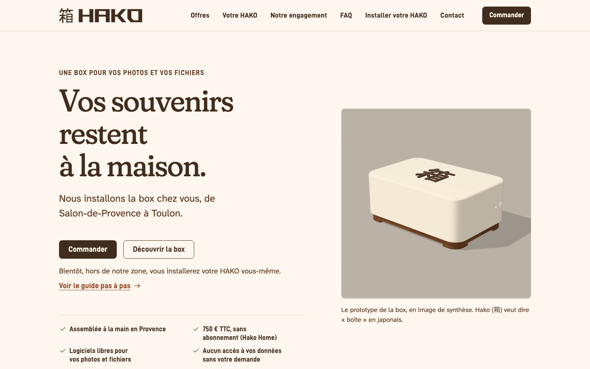
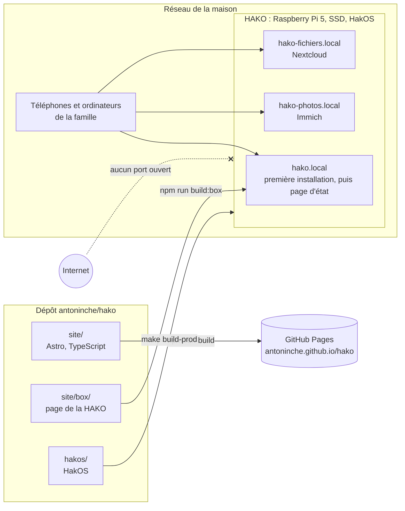

# HAKO 箱

**Vos souvenirs restent à la maison.**

## Pourquoi HAKO ? 🤩

- 🏠 **Vos données à la maison.** Les photos et les fichiers de la famille vivent sur une box chez vous, un Raspberry Pi 5 avec un SSD de 1 To (environ 300 000 photos), et non chez Google ou chez Apple. Hako (箱) veut dire « boîte » en japonais.
- 📸 **Immich et Nextcloud.** Deux logiciels libres déjà installés dans la box : Immich pour les photos, Nextcloud pour les fichiers, l'équivalent de Google Photos et de Google Drive.
- 🔒 **« Zéro accès ».** Aucun port n'est ouvert vers internet, et le système installé chez vous ne laisse aucune porte d'entrée à l'équipe : SSH désactivé, compte verrouillé, aucune clé. Les mots de passe sont créés par la box, chez vous, et personne d'autre ne les a, pas même nous. La contrepartie : on ne peut pas y accéder hors de chez soi.
- 🧰 **Installée chez vous.** De Salon-de-Provence à Toulon, en passant par Aix-en-Provence et Marseille, nous venons installer la box et former la famille sur place. Le « déménageur » aide à rapatrier les photos et les fichiers depuis Google Photos ou iCloud ; la famille se connecte elle-même, nous ne voyons jamais ses identifiants.
- 💶 **Achetée une fois.** Pour les familles, la box s'achète une seule fois, sans abonnement.

Envie d'en savoir plus ? [**Découvrez la box**](https://antoninche.github.io/hako/la-box/) et [**notre engagement**](https://antoninche.github.io/hako/engagement/).

## Obtenir votre HAKO 🚚

- 👪 **Hako Home**, pour les familles : 750 € TTC, achat unique, sans abonnement. Mises à jour de sécurité du système pendant 5 ans, renouvelables ; mise à jour des applications par nos soins, à la demande.
- 🏢 **Hako Pro**, pour les petites entreprises : 1 000 € TTC, puis 25 € TTC par mois avec un engagement de 2 ans, pour une réponse garantie sous 48 h, les mises à jour et la maintenance. Hako Pro ouvrira après le lancement de Hako Home.
- 💾 **Stockage** : 1 To compris ; 2 To pour 200 € de plus, 4 To pour 400 € de plus. Dans notre zone, l'installation et la formation sur place sont comprises.
- 🛒 [**Voir les offres**](https://antoninche.github.io/hako/offres/) puis [**commander**](https://antoninche.github.io/hako/commander/) : la box se paie en une seule fois, par virement, avant l'installation.
- 🛠️ **Vous préférez la monter vous-même ?** L'image de HakOS pour Raspberry Pi 5 est publiée dans la release [**HakOS 1.0.0**](https://github.com/antoninche/hako/releases/tag/hakos-v1.0.0), avec ses sommes SHA-256. Elle a été testée en machines virtuelles seulement : voir [hakos/README.md](hakos/README.md).

## Ce dépôt 🗂️

| Dossier              | Contenu                                                                                                    | Licence          | Documentation                                      |
| -------------------- | ---------------------------------------------------------------------------------------------------------- | ---------------- | -------------------------------------------------- |
| [site/](site/)       | le site de HAKO (Astro, TypeScript), et la page que la box affiche pour sa première installation           | MIT              | [site/README.md](site/README.md)                   |
| [hakos/](hakos/)     | HakOS, le système de la box : Raspberry Pi OS Lite pour Raspberry Pi 5, avec Immich et Nextcloud           | GPL-3.0-or-later | [hakos/README.md](hakos/README.md)                 |
| [.github/](.github/) | workflows (aperçu en ligne, HakOS, REUSE), formulaires d'issue, guide de contribution, images de ce README | MIT              | [.github/CONTRIBUTING.md](.github/CONTRIBUTING.md) |

Le site public et la box ne se parlent pas. La page de la box est construite depuis `site/`, à un commit figé, puis copiée dans l'image de HakOS : chez le client, elle ne charge rien d'internet.

## Nous contacter 💬

- [✉️ E-mail : antonin.chenavaz@etu.univ-amu.fr](mailto:antonin.chenavaz@etu.univ-amu.fr)
- [💼 LinkedIn](https://www.linkedin.com/company/box-hako/)
- [▶️ YouTube](https://www.youtube.com/@hako-v1k)
- [🌐 Le site](https://antoninche.github.io/hako/)

Une faille de sécurité ? Écrivez-nous en privé, comme l'explique [SECURITY.md](SECURITY.md).

## L'équipe 👪

Nous sommes trois étudiants d'Aix-Marseille, et HAKO est notre projet pour le 36h Chrono 2026 de Pépite Provence.

|  |  |  |
| :-----------------------------------------------------------------------------------------: | :---------------------------------------------------------------------------------------: | :--------------------------------------------------------------------------------------: |
|       **[Antonin Chenavaz](https://www.linkedin.com/in/antonin-chenavaz-9b9215421/)**       |        **[Maxime Pollaud](https://www.linkedin.com/in/maxime-pollaud-488a77397/)**        |        **[Martin Dugail](https://www.linkedin.com/in/martin-dugail-15a5a742b/)**         |
|                                     Logiciel et système                                     |                                Commerce et relation client                                |                                    Design et finance                                     |
|                           Licence MPCI, Aix-Marseille Université                            |                 BUT Techniques de commercialisation, IUT d'Aix-Marseille                  |                          Licence MPCI, Aix-Marseille Université                          |

## Développement 👩‍💻

### Le site

1. 📦 Installez Node.js 22.23.4 ou plus récent (le projet est testé avec Node 26, voir [site/.nvmrc](site/.nvmrc)).
2. ⬇️ Dans `site/`, installez les dépendances : `npm ci`, puis le navigateur des tests : `npx playwright install chromium`.
3. 🚀 Lancez `npm run dev` : le site s'ouvre sur http://localhost:4321 et se met à jour à chaque modification.
4. 🏗️ Construisez le site avec `npm run build`, et la page de la box avec `SITE_URL=https://antoninche.github.io/hako npm run build:box`.

Le détail est dans [site/README.md](site/README.md) et [site/docs/developpement.md](site/docs/developpement.md).

### HakOS

1. 🍎 Il faut un Mac Apple Silicon, environ 20 Gio libres, et `brew install colima docker docker-compose xz`.
2. 🐳 Démarrez la machine virtuelle Linux : `colima start --vm-type vz --arch aarch64 --cpu 6 --memory 8 --disk 60 --mount-type virtiofs`.
3. ✅ Lancez les contrôles : `make -C hakos lint`.
4. 🏗️ Construisez l'image des clients : `make -C hakos images`, puis `make -C hakos build-prod`, et vérifiez-la avec `make -C hakos verifier-image`.
5. 🧪 Essayez-la dans la machine virtuelle avec `hakos/scripts/essai-vm.sh`, puis arrêtez Colima : `colima stop`.

Le détail est dans [hakos/README.md](hakos/README.md) et [hakos/docs/manuel.md](hakos/docs/manuel.md).

### Tester

- 🎭 **Playwright** (Chromium) : chaque page du site à 390 et 1440 px de large, chaque lien interne, la politique de sécurité du contenu, aucune requête hors du site, aucun cookie, tout le parcours de la démonstration et la page de la box.
- ♿ **axe-core** : l'accessibilité de chaque page, visée WCAG 2.2 niveau AA.
- 🧩 **node --test** : les tests unitaires du site (`npm run test:unit`).
- 🧹 **astro check, ESLint et Prettier** : les types, les règles d'accessibilité et la mise en forme (`npm run lint`).
- 📦 **check:dist** : le site construit ne contient ni ressource d'un autre site, ni script ou style en ligne, ni cookie ou stockage local.
- 🚦 **Lighthouse** : performance et accessibilité du site servi comme en production (`npm run lighthouse`).
- 🐚 **shellcheck, docker compose config, recherche de secrets et unittest** : `make -C hakos lint` contrôle les scripts et les fichiers compose de HakOS, et lance les tests de son API locale et de son socle.
- 🔍 **verifier-image et essai-vm.sh** : une image construite, vérifiée sans la démarrer, puis démarrée dans une machine virtuelle avec `test-sur-boitier.sh`.
- 📜 **reuse lint** : chaque fichier a une licence et un titulaire du droit d'auteur.

## Où en est le projet ? 🧭

- 🎓 **Un projet étudiant.** HAKO est notre projet pour le 36h Chrono 2026 de Pépite Provence : le site est en ligne, et HakOS 1.0.0 est publié.
- ✅ **Testé en machines virtuelles.** HakOS y fait son premier démarrage et toute la première installation, jusqu'à la création des comptes de huit personnes.
- ⚠️ **Jamais démarré sur un vrai Raspberry Pi 5.** Le démarrage sur le SSD, l'EEPROM, la température et la durée réelle du premier démarrage restent à essayer sur le matériel.
- 🔓 **Des limites connues.** Les adresses de la maison sont en http, sans chiffrement, et il n'y a pas encore de copie de secours : gardez une autre copie de vos photos les plus précieuses. Le paiement en ligne n'est pas encore possible.
- 🔜 **Ensuite** :
  - [ ] premier démarrage de HakOS sur un vrai Raspberry Pi 5, et mesures (durée de l'installation, consommation) ;
  - [ ] mises à jour à la demande : la box saura qu'une nouvelle version existe, et la responsable la lancera avec son mot de passe ;
  - [ ] « Gérer ma HAKO » : depuis http://hako.local, ajouter une personne, lui donner un nouveau mot de passe ou la retirer ;
  - [ ] une copie de secours des données ;
  - [ ] hors de notre zone : envoyer la box, que la famille installe elle-même avec le guide pas à pas.

## Contribuer 📜

- ⚖️ **Licences par dossier.** Le site ([site/](site/)) est sous licence [MIT](site/LICENSE), HakOS ([hakos/](hakos/)) sous [GPL-3.0-or-later](hakos/LICENSE), les polices sous SIL Open Font License 1.1. La licence de chaque fichier est donnée par [REUSE.toml](REUSE.toml), et les textes sont dans [LICENSES/](LICENSES/).
- ™️ **Ce qui reste réservé.** Le nom HAKO, son logo, la marque en kanji 箱, les photos, les portraits, les dessins et les textes du site : voir [NOTICE](NOTICE). Immich et Nextcloud gardent leur propre licence (GNU AGPL v3).
- 🤝 **Comment contribuer.** Lisez le [guide de contribution](.github/CONTRIBUTING.md) : préparer le site et HakOS, tester, signer ses commits.
- 💛 **Code de conduite.** Chacun suit le [code de conduite](CODE_OF_CONDUCT.md) (Contributor Covenant 2.1).
- 🚨 **Sécurité.** Une faille se signale en privé : voir [SECURITY.md](SECURITY.md).
- 👥 **Auteurs.** Les fondateurs et leurs rôles sont dans [AUTHORS](AUTHORS).
