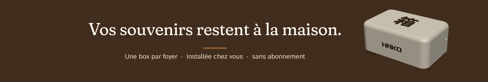
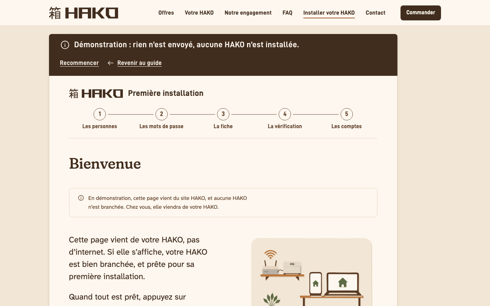
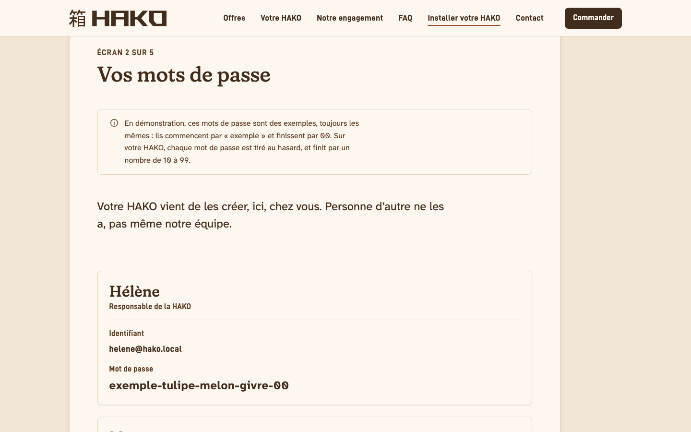
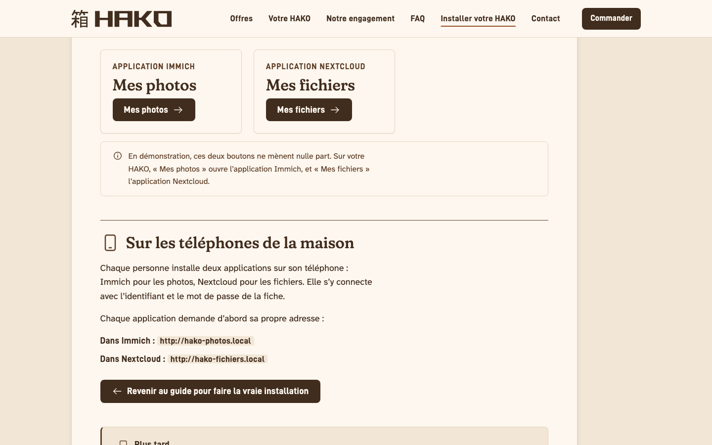
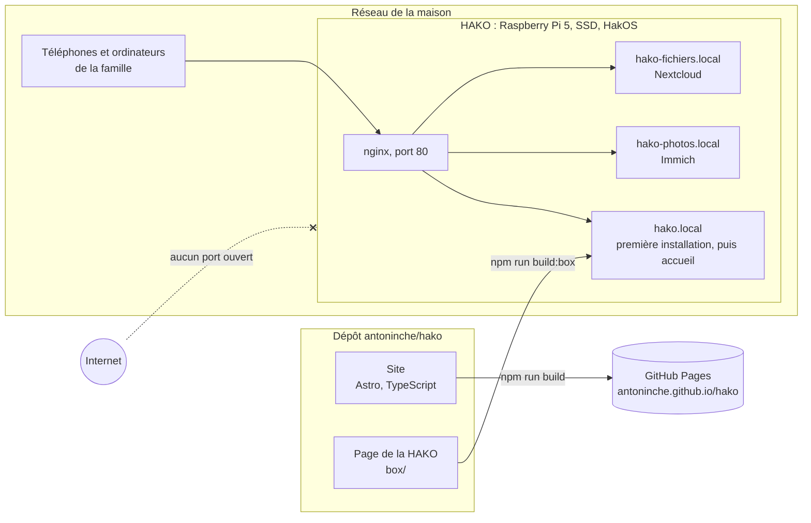

# HAKO

HAKO est une box qui garde les photos et les fichiers d'une famille chez elle, à la maison. Nous l'installons nous-mêmes chez nos clients, de Salon-de-Provence à Toulon, et nous leur apprenons à s'en servir sur place. Elle s'achète une fois, sans abonnement. Hako (箱) veut dire « boîte » en japonais.

Aujourd'hui, les photos d'une famille vivent souvent chez Google ou chez Apple, avec un abonnement à payer chaque mois pour y garder l'accès. Depuis 2018, le Cloud Act donne aux autorités américaines accès aux données détenues par les entreprises américaines, où qu'elles soient stockées. Les solutions qu'on garde chez soi, comme un NAS, sont à configurer soi-même. HAKO veut offrir les deux : les données à la maison, et rien à configurer.

Nous sommes trois étudiants d'Aix-Marseille, et HAKO est notre projet pour le 36h Chrono 2026 de Pépite Provence. Le site est en ligne sur [antoninche.github.io/hako](https://antoninche.github.io/hako/). Ce dépôt réunit le site, la page que la box affiche pour sa première installation et, bientôt, HakOS, le système de la box.

## Comment ça marche

- **La box.** Un Raspberry Pi 5 avec un SSD de 1 To (environ 300 000 photos), dans une coque imprimée en 3D, assemblée et vérifiée à la main en Provence. Au repos, elle consomme environ 3 W.
- **Des logiciels libres.** Immich pour les photos et Nextcloud pour les fichiers, l'équivalent de Google Photos et de Google Drive.
- **L'installation.** Dans notre zone, de Salon-de-Provence à Toulon en passant par Aix-en-Provence et Marseille, nous venons installer la box et former la famille sur place. Le « déménageur » aide à rapatrier les photos et les fichiers depuis Google Photos ou iCloud ; la famille se connecte elle-même à son compte, nous ne voyons jamais ses identifiants.
- **La première installation.** Branchée au réseau de la maison, la box affiche sa propre page à http://hako.local. La famille y donne ses prénoms, la box crée un compte et un mot de passe pour chacun, et la page fait imprimer une fiche de secours. Les photos s'ouvrent ensuite à http://hako-photos.local et les fichiers à http://hako-fichiers.local.
- **Aucun accès depuis l'extérieur.** Aucun port n'est ouvert vers internet : les données ne quittent pas la maison. La contrepartie : on ne peut pas y accéder hors de chez soi.
- **« Zéro accès ».** Le système installé chez les clients ne laisse aucune porte d'entrée à l'équipe : SSH désactivé, compte verrouillé, aucune clé. Les mots de passe sont créés par la box, chez le client, et personne d'autre ne les a, pas même nous.

## Les offres

| Offre     | Pour                    | Prix                    | Ensuite                                                                                                                                       |
| --------- | ----------------------- | ----------------------- | --------------------------------------------------------------------------------------------------------------------------------------------- |
| Hako Home | les familles            | 750 € TTC, achat unique | sans abonnement ; mises à jour de sécurité du système pendant 5 ans, renouvelables ; mise à jour des applications par nos soins, à la demande |
| Hako Pro  | les petites entreprises | 1 000 € TTC             | 25 € TTC par mois, engagement de 2 ans : assistance prioritaire (réponse sous 48 h), mises à jour et maintenance                              |

- 1 To de stockage compris ; 2 To pour 200 € de plus, 4 To pour 400 € de plus.
- Dans notre zone, l'installation chez le client et la formation sur place sont comprises dans les deux offres, comme le déménageur.
- Hors garantie, une intervention du service après-vente coûte 100 € TTC.
- La box se paie en une seule fois, par virement, avant l'installation : le paiement en ligne n'est pas encore possible.
- Hako Pro ajoute des comptes pour toute l'équipe avec des droits par dossier, un agenda et des contacts partagés, et un bilan de santé de la box chaque mois. Sa maintenance à distance passe par un tunnel chiffré (WireGuard), mis en place seulement si le client la demande. Elle ouvrira après le lancement de Hako Home.

## L'équipe

| Fondateur                                                                   | Rôle                        | Formation                                                |
| --------------------------------------------------------------------------- | --------------------------- | -------------------------------------------------------- |
| [Antonin Chenavaz](https://www.linkedin.com/in/antonin-chenavaz-9b9215421/) | Logiciel et système         | Licence MPCI, Aix-Marseille Université                   |
| [Maxime Pollaud](https://www.linkedin.com/in/maxime-pollaud-488a77397/)     | Commerce et relation client | BUT Techniques de commercialisation, IUT d'Aix-Marseille |
| [Martin Dugail](https://www.linkedin.com/in/martin-dugail-15a5a742b/)       | Design et finance           | Licence MPCI, Aix-Marseille Université                   |

Nous écrire : [antonin.chenavaz@etu.univ-amu.fr](mailto:antonin.chenavaz@etu.univ-amu.fr).

## Le site

Treize pages, plus la page 404 : accueil, offres, la box, notre engagement, questions fréquentes, tutoriels, guide d'installation en huit étapes, démonstration de la première installation, commande, contact, conditions générales de vente, mentions légales et données personnelles.

- Site statique construit avec Astro 7 et TypeScript en mode strict, publié par GitHub Pages à chaque envoi sur `main`.
- Aucun cookie, aucun stockage local, aucune mesure d'audience, aucune ressource externe : les polices, le logo et les icônes sont servis par le site.
- Aucun script ni style en ligne : chaque page tient sous une politique de sécurité du contenu (CSP) stricte, `default-src 'self'`, que les tests vérifient à 390 et 1440 px. GitHub Pages n'envoie pas cet en-tête ; l'hébergement définitif l'enverra ([docs/hebergement.md](docs/hebergement.md)).
- Accessibilité visée WCAG 2.2 niveau AA, contrôlée avec axe-core, à 390 et 1440 px de large ; contraste d'au moins 4,5:1 pour chaque couple texte et fond, cibles tactiles de 44 px, menu au clavier, moins d'animations sur demande.
- 237 tests unitaires et 429 tests Playwright dans Chromium : chaque page, chaque lien interne, aucune requête hors du site, aucun cookie, la politique de sécurité et tout le parcours de la démonstration.
- Une vue 3D de la box avec three.js, chargée seulement quand elle approche de l'écran, avec une image fixe à la place si les animations sont réduites ou sans WebGL.
- Une information encore inconnue (numéro de téléphone, durée à mesurer…) garde un texte provisoire, et `npm run todos` en tient la liste dans [TODO.md](TODO.md).
- La page de la box est construite à part (`npm run build:box`), avec les mêmes composants que la démonstration, et copiée dans l'image de HakOS.

|                                                              |                                                                                      |
| ------------------------------------------------------------ | ------------------------------------------------------------------------------------ |
|  |  |
| Les deux offres, avec leur prix.                             | Le guide d'installation, une étape à la fois.                                        |

|                                                                                                    |                                                                                               |                                                                                             |
| -------------------------------------------------------------------------------------------------- | --------------------------------------------------------------------------------------------- | ------------------------------------------------------------------------------------------- |
|  |  |  |
| La démonstration de la première installation, telle que la box l'affiche.                          | Les mots de passe, créés par la box (ici, ceux de la démonstration).                          | La fin : les adresses des photos et des fichiers.                                           |

Installer le site, le construire, le tester et le modifier : [docs/developpement.md](docs/developpement.md).

## Architecture

Le site public et la box ne se parlent pas. La page de la box est construite depuis ce dépôt, à un commit figé, puis copiée dans l'image de HakOS : chez le client, elle ne charge rien d'internet. Dans la maison, nginx reçoit les visites et dirige chaque nom vers sa page ou son application.

## HakOS, le système de la box

HakOS est une image Raspberry Pi OS Lite (Debian 13, arm64) pour Raspberry Pi 5, qui démarre sur le SSD. Immich et Nextcloud sont livrés dans l'image : rien n'est téléchargé chez le client, et chaque box tire ses propres secrets à son premier démarrage.

- Construit et testé dans des machines virtuelles ; pas encore démarré sur un vrai Raspberry Pi 5.
- Son code rejoint ce dépôt dans le dossier `hakos/`, sous licence GPL-3.0-or-later : voir [hakos/README.md](hakos/README.md).

## Feuille de route

- [ ] Premier démarrage de HakOS sur un vrai Raspberry Pi 5, et mesures (durée de l'installation, consommation).
- [ ] Mises à jour à la demande : la box saura qu'une nouvelle version existe, et la responsable la lancera avec son mot de passe.
- [ ] « Gérer ma HAKO » : depuis http://hako.local, ajouter une personne, lui donner un nouveau mot de passe ou la retirer. Aujourd'hui, ces gestes se font à la main dans Immich et Nextcloud.
- [ ] Une copie de secours des données. En attendant, nous conseillons de garder une autre copie des photos les plus précieuses.
- [ ] Hors de notre zone : envoyer la box, que la famille installe elle-même avec le guide pas à pas.

## Organisation du dépôt

| Dossier              | Contenu                                                                                        |
| -------------------- | ---------------------------------------------------------------------------------------------- |
| [src/](src/)         | Pages, textes (`content/`), informations de l'entreprise et prix (`data/`), composants, styles |
| [box/](box/)         | Page de la HAKO pour sa première installation ([docs/page-box.md](docs/page-box.md))           |
| [public/](public/)   | Fichiers servis tels quels : polices et leurs licences, logo, icônes, image de partage         |
| [design/](design/)   | Captures du prototype 3D et sources des dessins                                                |
| [brand/](brand/)     | PNG d'origine du logo                                                                          |
| [scripts/](scripts/) | Contrôles (informations manquantes, contraste, site construit), polices, logo, page de la HAKO |
| [tests/](tests/)     | Tests Playwright et tests unitaires                                                            |
| [docs/](docs/)       | Développement, charte graphique, hébergement, page de la HAKO, licences                        |
| [images/](images/)   | Bannière et captures d'écran de ce README                                                      |

## Licence

Le code du site est distribué sous licence [MIT](LICENSE). Elle permet de le réutiliser, de le modifier et de le redistribuer, à condition de garder la mention de copyright et la licence.

Elle ne donne aucun droit sur le nom HAKO, son logo, la marque en kanji 箱, les dessins, les photos ni les textes du site : ils restent réservés (voir [NOTICE](NOTICE)). Les polices Fraunces, Atkinson Hyperlegible Next et D-DIN sont sous licence SIL Open Font License 1.1, jointe dans [public/fonts/](public/fonts/), et les autres éléments tiers sont listés avec leur licence dans [docs/licences.md](docs/licences.md). Immich et Nextcloud gardent leur propre licence (GNU AGPL v3).
