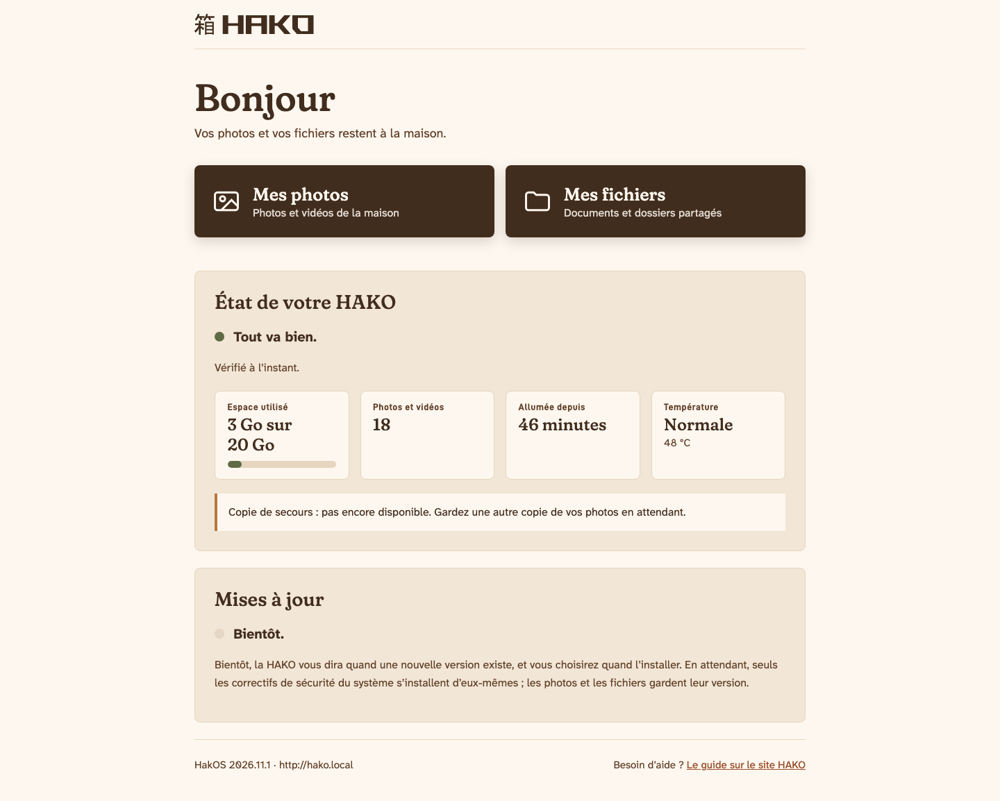
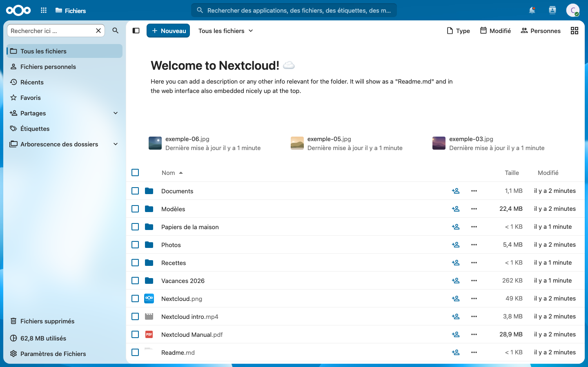

# HakOS 箱

[](https://github.com/antoninche/hako/actions/workflows/hakos.yml)
[](https://github.com/antoninche/hako/releases/latest)
[](../LICENSE)

**Le système de la box HAKO : vos photos et vos fichiers sur un Raspberry Pi 5, à la maison.**



HakOS est une image Raspberry Pi OS Lite (Debian 13 « trixie », arm64) pour Raspberry Pi 5, qui démarre sur un SSD. Elle fait tourner Immich pour les photos et Nextcloud pour les fichiers, à la maison : la box ne télécharge rien chez vous, aucun port n'est ouvert vers internet, et l'équipe n'a aucun accès à la box.

**HakOS a été testé dans des machines virtuelles seulement, jamais sur un vrai Raspberry Pi 5** : voir [Limites](#limites).

## Installer

Il vous faut un Raspberry Pi 5, un SSD NVMe sur une carte M.2 pour Raspberry Pi 5, l'alimentation officielle de 27 W, un câble Ethernet relié au réseau de la maison et un ordinateur pour graver le SSD.

1. **Télécharger.** Dans la [dernière release](https://github.com/antoninche/hako/releases/latest), prenez l'image `image_AAAA-MM-JJ-hakos-prod.img.xz` et le fichier `SHA256SUMS`, dans le même dossier.
2. **Vérifier.** Dans ce dossier : `shasum -a 256 -c SHA256SUMS`. La ligne de l'image doit finir par « OK ».
3. **Graver le SSD.** Toutes ses données sont effacées.
   - Avec Raspberry Pi Imager 2.x : « Utiliser image personnalisée », choisir le `.img.xz`, puis le SSD, sans aucune personnalisation.
   - Ou, sur un Mac, avec [scripts/flasher-ssd.sh](scripts/flasher-ssd.sh). Le script vérifie l'empreinte de l'image avec `SHA256SUMS`, refuse un disque interne ou un disque de Mac, demande de retaper l'identifiant du disque, écrit l'image, la relit en entier et éjecte le SSD :

     ```sh
     diskutil list external physical    # avant, puis après avoir branché le SSD : il apparaît en diskN
     scripts/flasher-ssd.sh --simulation image_AAAA-MM-JJ-hakos-prod.img.xz diskN   # vérifie tout, n'écrit rien
     scripts/flasher-ssd.sh image_AAAA-MM-JJ-hakos-prod.img.xz diskN
     ```

   Gravez toujours le `.img.xz` : ne fabriquez jamais une box en copiant un SSD déjà démarré, car chaque box tire ses propres secrets à son premier démarrage.

4. **Premier démarrage.** Box éteinte : SSD en place, aucune carte microSD, câble Ethernet branché, puis l'alimentation. La box agrandit sa partition, puis le service `hakos-premier-demarrage` tire ses secrets (identifiant de machine, clés SSH, mots de passe des bases de données), charge les images Docker, démarre le pare-feu, la page de la HAKO, Immich et Nextcloud, et attend qu'ils soient prêts. Ne coupez pas le courant pendant ce temps. Dans une machine virtuelle, cela prend de 90 à 93 secondes ; sur le Pi 5, la durée n'a pas été mesurée. Le service abandonne si les applications ne sont pas prêtes au bout de 15 minutes.
5. **Première installation.** Depuis un appareil du réseau de la maison, ouvrez http://hako.local. La page demande les prénoms de la famille, crée un compte pour chacun dans Immich et dans Nextcloud, avec un mot de passe de quatre mots et un nombre tiré par la box, puis fait imprimer une fiche de secours avec ces mots de passe. La première personne qui ouvre la page commence l'installation : faites-la dès que la box est prête. Ensuite, http://hako.local devient la page d'état.

### Wi-Fi

L'Ethernet reste la connexion conseillée. L'image ne connaît aucun Wi-Fi, et l'image publiée n'a pas d'accès SSH : le Wi-Fi ne peut se donner qu'avant le premier démarrage, dans le fichier `network-config` de la partition bootfs, que cloud-init lit à ce premier démarrage seulement. **Ce chemin n'a pas encore été vérifié sur une box.**

Après la gravure, rebranchez le SSD à l'ordinateur ; le volume « bootfs » apparaît. Dans un éditeur de texte brut, ouvrez `network-config`, gardez ses lignes de commentaire et ajoutez à la fin, en indentant avec des espaces, jamais des tabulations :

```yaml
network:
  version: 2
  ethernets:
    eth0:
      dhcp4: true
      optional: true
  wifis:
    wlan0:
      dhcp4: true
      optional: true
      regulatory-domain: FR
      access-points:
        "Nom du réseau":
          password: "<mot de passe du Wi-Fi>"
```

C'est le format netplan v2 de l'exemple commenté que Raspberry Pi met dans ce même fichier. Ne touchez à aucun autre fichier de bootfs, puis éjectez le SSD. Le mot de passe du Wi-Fi reste lisible en clair sur bootfs.

### Si la box affiche « Votre HAKO ne peut pas démarrer »

Au premier démarrage, la box vérifie que le noyau utilise des pages mémoire de 4 Kio, celles que prévoient les images Docker. Si le noyau tourne avec des pages de 16 Kio, elle s'arrête avant d'installer Immich et Nextcloud, sans rien abîmer, et http://hako.local affiche cette page d'arrêt. La cause : la ligne `kernel=kernel8.img` manque dans la section `[pi5]` du fichier `config.txt`.

1. Débranchez la box, puis branchez le SSD à l'ordinateur ; le volume « bootfs » apparaît.
2. Ouvrez `config.txt` dans un éditeur de texte brut et vérifiez qu'il finit par ces trois lignes, que l'image écrit d'elle-même ; ajoutez-les si elles manquent :

   ```text
   [pi5]
   kernel=kernel8.img
   [all]
   ```

3. Éjectez le SSD, remettez-le dans la box et rallumez-la. Le premier démarrage reprend tant qu'il n'est pas allé au bout ; si les pages sont de 4 Kio, la page d'arrêt disparaît. Si le message reste, écrivez-nous depuis la [page Contact du site](https://antoninche.github.io/hako/contact/).

Ce cas n'a été essayé que dans une machine virtuelle, en simulant un noyau à pages de 16 Kio.

## Ce que contient la box

Toutes les versions sont figées dans [versions.env](versions.env), les images Docker aussi par leur empreinte quand elles en ont une. Elles sont enregistrées dans l'image système et chargées au premier démarrage : chez vous, la box ne télécharge rien.

| Élément                                    | Rôle                                                  | Version figée                                                   |
| ------------------------------------------ | ----------------------------------------------------- | --------------------------------------------------------------- |
| Raspberry Pi OS Lite, construit par pi-gen | le système                                            | Debian 13 « trixie », arm64 ; pi-gen, branche arm64, `c0d2c9f2` |
| Immich                                     | les photos, à http://hako-photos.local                | v3.4.1, avec Postgres 14 (VectorChord 0.4.3) et Valkey 9        |
| Nextcloud                                  | les fichiers, à http://hako-fichiers.local            | 34.0.5-apache, avec postgres:17.12-alpine                       |
| nginx                                      | page de la HAKO, page d'état, entrée des applications | 1.31.8-alpine                                                   |
| Page de la HAKO                            | la première installation, sur http://hako.local       | construite depuis `site/` au commit `4fcd7dd` (site 0.4.2)      |
| HakOS                                      | version affichée sur la page d'état                   | 2026.11.2                                                       |

Docker Engine et son greffon compose viennent du dépôt officiel de Docker pour Debian 13, le jour de la construction. Ensuite, seuls les correctifs de sécurité de Debian s'installent d'eux-mêmes. La recherche intelligente d'Immich est activée sur un Pi 5 de 8 Go, coupée sur un Pi 5 de 4 Go.

- **Pare-feu.** Le service `hakos-parefeu` (nftables) n'accepte de connexion que depuis le réseau de la maison. La box n'ouvre aucun port vers internet : on ne peut pas y accéder hors de chez soi.
- **« Zéro accès ».** L'image publiée ne laisse aucune porte d'entrée à l'équipe : SSH masqué, compte `hako` verrouillé, aucune clé. Les mots de passe des comptes sont créés par la box, chez vous, et personne d'autre ne les a. L'image de l'équipe, avec SSH, n'est pas publiée.
- **Noms.** avahi (service `hakos-noms`) annonce les noms en `.local` sur le réseau de la maison ; une deuxième box prend `hako-2.local`, `hako-2-photos.local` et `hako-2-fichiers.local`. Les ports 2283 (Immich) et 8080 (Nextcloud) restent ouverts au réseau de la maison après l'installation, en secours.
- **Page d'état.** Après l'installation, http://hako.local montre « Mes photos », « Mes fichiers », l'espace utilisé, le nombre de photos et de vidéos, la durée depuis l'allumage et la température. Elle lit cet état, sans aucun secret, à http://hako.local/api/etat.
- **API locale.** `hakos-assistant`, en Python sans dépendance, sert la première installation à la page de la HAKO, dont le client est dans [site/src/lib/assistant/](../site/src/lib/assistant/) ; il s'arrête et se masque une fois l'installation finie.

|                                                                         |                                            |                                                    |
| ----------------------------------------------------------------------- | ------------------------------------------ | -------------------------------------------------- |
|  |  |  |
| La page d'état, sur http://hako.local.                                  | Immich, sur http://hako-photos.local.      | Nextcloud, sur http://hako-fichiers.local.         |

Captures prises avec HakOS 2026.11.1, dans une machine virtuelle, avec des données d'exemple.

## Construire

Il faut un Mac Apple Silicon (la construction est native, en arm64), Colima, docker, le greffon docker compose, xz, git et curl, et environ 20 Gio libres. Le dépôt doit être dans un chemin sans espace ni caractère spécial, hors OneDrive ou iCloud, par exemple ~/Code/hako.

```sh
brew install colima docker docker-compose xz
colima start --vm-type vz --arch aarch64 --cpu 6 --memory 8 --disk 60 --mount-type virtiofs
cd hakos
make lint            # shellcheck, fichiers compose, recherche de secrets, tests unitaires
make images          # les 7 images Docker figées, en arm64, dans images/ (1,4 Gio)
make build-prod      # image publiée, dans deploy/, avec SHA256SUMS et le journal
make verifier-image  # contrôle l'image la plus récente de deploy/, sans la démarrer
colima stop
```

`docker compose version` doit répondre : Homebrew explique comment déclarer le greffon (`cliPluginsExtraDirs` dans ~/.docker/config.json). [scripts/verifier-hote.sh](scripts/verifier-hote.sh) contrôle la machine avant la construction. `make build-dev` construit l'image de l'équipe, avec SSH : il lui faut les clés publiques dans `local/cles-ssh-dev.pub`. `make clean` supprime deploy/ et images/ après confirmation. Les dossiers local/, images/, pi-gen/ et deploy/ ne sont jamais versionnés.

Après un échec, le conteneur pigen_work reste pour le diagnostic (`docker logs pigen_work`) : supprimez-le avant de relancer (`docker rm -v pigen_work`).

## Tester dans une machine virtuelle

Sans Raspberry Pi, [scripts/essai-vm.sh](scripts/essai-vm.sh) installe une box neuve dans la VM Colima, à partir d'une image construite, et lance le vrai premier démarrage par systemd, comme sur un Pi 5 de 4 Go :

```sh
colima ssh -- sudo apt-get install -y avahi-daemon avahi-utils   # une fois, pour les noms en .local
colima ssh -- sudo "$PWD/scripts/essai-vm.sh" installer "$PWD/deploy/image_AAAA-MM-JJ-hakos-prod.img.xz"
colima ssh -- sudo env HAKOS_ESSAI=1 HAKOS_MEMOIRE_KIO=4000000 /opt/box/test-sur-boitier.sh --assistant 8
colima ssh -- sudo "$PWD/scripts/essai-vm.sh" defaire
```

Le test affiche une ligne « OK » ou « ÉCHEC » par contrôle et finit par un bilan. Avec `--assistant 8`, il fait aussi toute la première installation pour huit personnes. `HAKOS_PAGE_OCTETS=16384` simule un noyau à pages de 16 Kio : le premier démarrage doit alors s'arrêter et servir la page d'arrêt.

## Limites

HakOS n'a jamais tourné sur un vrai Raspberry Pi 5. Restent à vérifier sur le matériel :

- le démarrage sur le SSD NVMe, la version réelle de l'EEPROM et sa mise à jour ;
- le noyau réellement chargé (kernel8.img, pages de 4 Kio) et la page d'arrêt sur un vrai noyau à pages de 16 Kio ;
- la température, les ralentissements et le flux d'air du boîtier ;
- les noms en `.local` sur iPhone, Android, Mac et Windows, et ceux d'une deuxième box ;
- la durée du premier démarrage, et le Wi-Fi donné par `network-config`.

Autres limites connues :

- **Adresses en http**, sans chiffrement : à la maison, mots de passe, photos et fichiers circulent en clair sur le réseau local.
- **Pas de copie de secours** pour l'instant : une panne du SSD perd les photos et les fichiers. Gardez une autre copie des photos les plus précieuses.
- **Mises à jour** : une nouvelle version d'Immich ou de Nextcloud demande une nouvelle image, et regraver le SSD efface les données.
- **Comptes** : ajouter une personne, changer un mot de passe ou retirer quelqu'un se fait à la main dans Immich et Nextcloud.
- **cloud-init est gardé** : qui a le SSD en main peut faire lancer des commandes au démarrage et lire les données, le disque n'étant pas chiffré.

## Licence

Le code de HakOS est sous licence GNU GPL version 3 ou ultérieure, comme tout le dépôt : voir [LICENSE](../LICENSE). Les logiciels livrés dans l'image gardent leur propre licence : Immich et Nextcloud sont sous GNU AGPL v3, Raspberry Pi OS et pi-gen sous les leurs. Le nom HAKO, son logo et la marque en kanji 箱 restent réservés : voir [NOTICE](../NOTICE).
