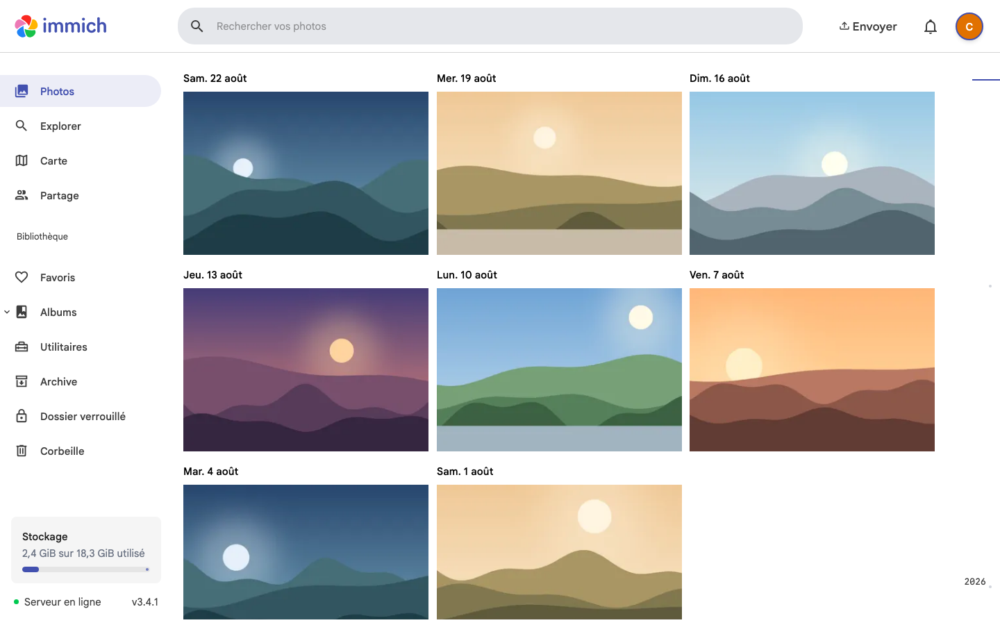
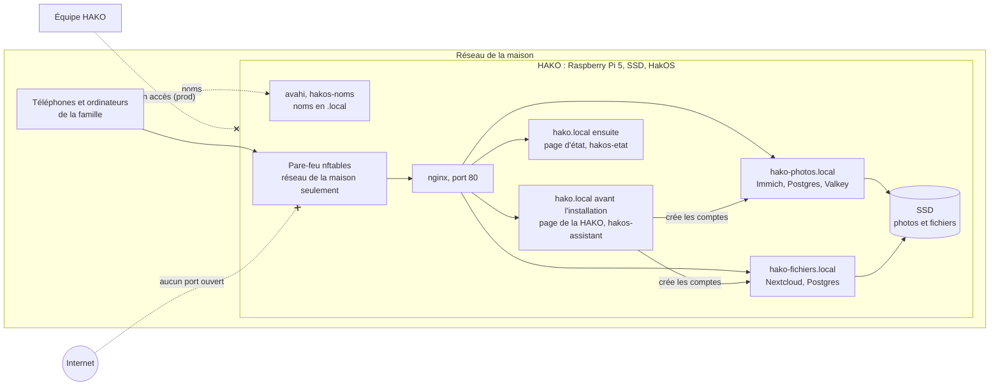

# HakOS 箱

[](https://github.com/antoninche/hako/actions/workflows/hakos.yml)
[](https://github.com/antoninche/hako/releases/latest)
[](LICENSE)
[](https://github.com/antoninche/hako/actions/workflows/reuse.yml)

**Le système de la box HAKO : vos photos et vos fichiers sur un Raspberry Pi 5, à la maison.**


HakOS est le système de la box HAKO : une image Raspberry Pi OS Lite (Debian 13 « trixie », arm64) pour Raspberry Pi 5, qui démarre sur un SSD. Il fait tourner Immich pour les photos et Nextcloud pour les fichiers, à la maison : rien n'est téléchargé chez le client, aucun port n'est ouvert vers internet, et l'équipe n'a aucun accès à la box.

L'image est construite avec pi-gen, l'outil officiel de Raspberry Pi, sur un Mac Apple Silicon, dans une machine virtuelle Linux (Colima). Elle a été essayée dans des machines virtuelles seulement, jamais sur un vrai Raspberry Pi 5 : voir la section « Limites » plus bas.

Ce dossier reprend le dépôt de travail de HakOS, avec son historique, dans le dépôt antoninche/hako : sa présentation générale est dans le [README du dépôt](../README.md), et le site de HAKO, avec la page que la box affiche pour sa première installation, dans [site/](../site/). Les images prêtes à graver sont publiées dans la release [HakOS 1.0.0](https://github.com/antoninche/hako/releases/tag/hakos-v1.0.0).

## Ce que contient la box

Toutes les versions sont figées dans [versions.env](versions.env) ; les images Docker le sont aussi par leur empreinte quand elles en ont une. Elles sont enregistrées dans l'image système et chargées au premier démarrage : chez le client, la box ne télécharge rien.

| Élément                                    | Rôle                                                  | Version figée                                                   |
| ------------------------------------------ | ----------------------------------------------------- | --------------------------------------------------------------- |
| Raspberry Pi OS Lite, construit par pi-gen | le système                                            | Debian 13 « trixie », arm64 ; pi-gen, branche arm64, `c0d2c9f2` |
| Immich                                     | les photos, à http://hako-photos.local                | v3.4.1, avec Postgres 14 (VectorChord 0.4.3) et Valkey 9        |
| Nextcloud                                  | les fichiers, à http://hako-fichiers.local            | 34.0.5-apache, avec postgres:17.12-alpine                       |
| nginx                                      | page de la HAKO, page d'état, entrée des applications | 1.31.8-alpine                                                   |
| Page de la HAKO                            | la première installation, sur http://hako.local       | construite depuis `site/` au commit `4fcd7dd` (site 0.4.2)      |
| HakOS                                      | version affichée sur la page d'état                   | 2026.11.2                                                       |

Docker Engine et son greffon compose viennent du dépôt officiel de Docker pour Debian 13, le jour de la construction. Ensuite, seuls les correctifs de sécurité de Debian s'installent d'eux-mêmes : ni Docker, ni Immich, ni Nextcloud ne changent de version seuls.

Deux profils sont construits à partir des mêmes fichiers :

| Profil | Pour        | Accès à la box                                                                       |
| ------ | ----------- | ------------------------------------------------------------------------------------ |
| dev    | l'équipe    | SSH par clé seulement (clés de l'équipe), compte `hako` avec un mot de passe console |
| prod   | les clients | aucun : SSH masqué, compte `hako` verrouillé, aucune clé (« zéro accès »)            |

L'image dev ne doit jamais être installée chez un client, et elle n'est pas publiée.

## Premier démarrage

Au premier démarrage, la box agrandit sa partition, puis le service `hakos-premier-demarrage` fait, une seule fois :

1. **Garde-fous du Pi 5.** Il note la version de l'EEPROM et vérifie que le noyau utilise des pages mémoire de 4 Kio ; sinon, il s'arrête et affiche une page d'arrêt sur http://hako.local.
2. **Secrets propres à la box.** Identifiant de machine, clés SSH et mots de passe des bases de données sont tirés au hasard, dans des fichiers `.env` lisibles par root seul. Deux box gravées avec la même image ne partagent aucun secret.
3. **Mémoire.** La recherche intelligente d'Immich est activée à partir de 7 Gio de mémoire (Pi 5 de 8 Go), coupée en dessous (Pi 5 de 4 Go).
4. **Applications.** Il charge les 7 images Docker depuis leurs archives, puis les supprime ; il démarre le pare-feu, la page de la HAKO, Immich et Nextcloud, et attend qu'ils soient en bonne santé.
5. **Nextcloud.** Il l'installe sans intervention et supprime son compte technique.
6. **Fin.** Il écrit une fiche technique sans secret, puis pose le marqueur `/opt/box/.initialized`, seulement si tout a réussi.

Dans la machine virtuelle, l'image prod a fait tout cela en 90 à 93 secondes. Sur le Pi 5, la durée reste à mesurer.

## La première installation

Branchée au réseau de la maison, la box affiche sa propre page à http://hako.local : la page de la HAKO, construite depuis le site, dans ce dépôt. La première personne qui l'ouvre commence l'installation :

- **Les prénoms** : la famille donne ses prénoms ;
- **Les comptes** : la box crée un compte pour chacun dans Immich et dans Nextcloud, avec un mot de passe de quatre mots et un nombre, tiré par la box ;
- **La fiche de secours** : la page fait imprimer une fiche de secours avec les mots de passe ;
- **La fin** : l'assistant (`hakos-assistant`, une API locale en Python, sans dépendance) s'arrête ensuite et se masque.

D'ici là, Immich et Nextcloud restent fermés au réseau : personne ne peut y prendre un compte administrateur. Une fois la box installée, http://hako.local devient la page d'état.

## Pare-feu et « zéro accès »

- **Pare-feu.** Le service `hakos-parefeu` (nftables) démarre avant Docker. Il n'accepte de connexion TCP que depuis les adresses IPv4 privées, celles du réseau de la maison, et rien en IPv6 hors ce qu'il faut au réseau lui-même. Les ports des photos (2283) et des fichiers (8080) restent fermés jusqu'à la fin de l'installation.
- **Aucun accès depuis l'extérieur.** La box n'ouvre aucun port vers internet : les données ne quittent pas la maison. La contrepartie : on ne peut pas y accéder hors de chez soi.
- **Mots de passe.** Immich n'accepte que 10 essais de mot de passe par minute et par adresse.
- **« Zéro accès ».** L'image prod ne laisse aucune porte d'entrée à l'équipe : SSH masqué, compte verrouillé, aucune clé, mot de passe console tiré au hasard puis jeté. Les mots de passe des comptes sont créés par la box, chez le client, et personne d'autre ne les a, pas même nous.

## Les noms

| Adresse                    | Ce qu'elle ouvre                                              |
| -------------------------- | ------------------------------------------------------------- |
| http://hako.local          | la page de la HAKO avant l'installation, la page d'état après |
| http://hako-photos.local   | Immich, les photos                                            |
| http://hako-fichiers.local | Nextcloud, les fichiers                                       |

Les noms sont annoncés sur le réseau de la maison par avahi (service `hakos-noms`), puis nginx dirige chaque nom vers sa page ou son application, sur le port 80. Une deuxième box sur le même réseau prend `hako-2.local`, `hako-2-photos.local` et `hako-2-fichiers.local`. Les ports 2283 (Immich) et 8080 (Nextcloud) restent ouverts au réseau de la maison après l'installation, en secours, par le nom ou l'adresse IP de la box.

## La page d'état

Après l'installation, http://hako.local montre les boutons « Mes photos » et « Mes fichiers », puis l'état de la box : espace utilisé, nombre de photos et de vidéos, durée depuis l'allumage, température et ralentissements, et la copie de secours, pas encore disponible. Le service `hakos-etat` écrit cet état chaque minute ; la page le lit en JSON, sans aucun secret, à http://hako.local/api/etat. Les mises à jour y sont annoncées « bientôt ».

|                                                                         |                                            |                                                    |
| ----------------------------------------------------------------------- | ------------------------------------------ | -------------------------------------------------- |
|  |  |  |
| La page d'état, sur http://hako.local.                                  | Immich, sur http://hako-photos.local.      | Nextcloud, sur http://hako-fichiers.local.         |

Captures prises avec l'image prod de HakOS 2026.11.1, dans une machine virtuelle, avec des données d'exemple.

## Architecture



## Construire

Il faut un Mac Apple Silicon (la construction est native, en arm64), Colima, docker, le greffon docker compose, xz, git et curl, et environ 20 Gio libres. Le dépôt doit être dans un chemin sans espace, hors OneDrive ou iCloud.

```sh
brew install colima docker docker-compose xz
colima start --vm-type vz --arch aarch64 --cpu 6 --memory 8 --disk 60 --mount-type virtiofs
cd hakos
make lint            # contrôles : shellcheck, fichiers compose, secrets, tests unitaires
make images          # les 7 images Docker figées, en arm64, dans images/ (1,4 Gio)
make build-prod      # image des clients, dans deploy/
make verifier-image  # contrôle l'image la plus récente de deploy/, sans la démarrer
colima stop
```

| Commande              | Ce qu'elle fait                                                                                                                   |
| --------------------- | --------------------------------------------------------------------------------------------------------------------------------- |
| `make lint`           | shellcheck, `docker compose config` sur chaque fichier compose, recherche de secrets, tests unitaires de l'API locale et du socle |
| `make images`         | récupère les images Docker de versions.env, vérifie leur empreinte et les enregistre dans images/                                 |
| `make build-prod`     | construit l'image des clients (`make build` fait la même chose)                                                                   |
| `make build-dev`      | construit l'image de l'équipe ; il faut d'abord ses clés publiques SSH dans local/cles-ssh-dev.pub                                |
| `make verifier-image` | monte l'image en lecture seule dans la VM, fait une trentaine de contrôles, puis défait tout                                      |
| `make clean`          | supprime deploy/ et images/ après confirmation, jamais local/                                                                     |

L'image arrive dans deploy/, avec SHA256SUMS et le journal de construction. pi-gen est récupéré à la révision figée dans pi-gen/ ; local/, images/, pi-gen/ et deploy/ ne sont jamais versionnés. Le détail (construction, gravure d'un SSD, test sur la box, Wi-Fi) est dans [docs/manuel.md](docs/manuel.md).

## Tester dans une machine virtuelle

Sans Raspberry Pi, `scripts/essai-vm.sh` installe une box neuve dans la VM Colima, à partir d'une image construite, et lance le vrai premier démarrage par systemd, comme sur un Pi 5 de 4 Go :

```sh
colima ssh -- sudo apt-get install -y avahi-daemon avahi-utils   # une fois, pour les noms en .local
colima ssh -- sudo "$PWD/scripts/essai-vm.sh" installer "$PWD/deploy/image_AAAA-MM-JJ-hakos-prod.img.xz"
colima ssh -- sudo env HAKOS_ESSAI=1 HAKOS_MEMOIRE_KIO=4000000 /opt/box/test-sur-boitier.sh --assistant 8
colima ssh -- sudo "$PWD/scripts/essai-vm.sh" defaire
```

Le test affiche une ligne « OK » ou « ÉCHEC » par contrôle et finit par un bilan. Avec `--assistant 8`, il fait aussi toute la première installation pour huit personnes. `HAKOS_PAGE_OCTETS=16384` simule un noyau à pages de 16 Kio : le premier démarrage doit alors s'arrêter et servir la page d'arrêt.

## Limites

HakOS n'a jamais tourné sur un vrai Raspberry Pi 5. Ce qui ne peut pas se vérifier sans lui :

- **Démarrage** : le démarrage sur le SSD (NVMe), la version réelle de l'EEPROM et sa mise à jour par rpi-eeprom-update ;
- **Noyau** : le noyau réellement chargé (kernel8.img, pages de 4 Kio), et la page d'arrêt sur un vrai noyau à pages de 16 Kio ;
- **Température** : la température et les ralentissements réels (la VM reçoit 48,3 °C d'exemple), et le flux d'air du boîtier ;
- **Noms** : la résolution de hako-photos.local et hako-fichiers.local sur iPhone, Android, Mac et Windows (avec et sans Bonjour), et celle d'une deuxième box ;
- **Durées** : la durée du premier démarrage sur le Pi, et le comptage des photos sur une grosse photothèque.

Autres limites, connues :

- **Adresses en http**, sans chiffrement : à la maison, mots de passe, photos et fichiers circulent en clair sur le réseau local.
- **Pas de sauvegarde** pour l'instant : une panne du SSD perd les photos et les fichiers. Nous conseillons de garder une autre copie des photos les plus précieuses.
- **Première installation** : la première personne qui ouvre http://hako.local la commence ; un autre appareil du réseau de la maison pourrait passer avant la famille.
- **cloud-init est gardé** : qui a le SSD en main peut faire lancer des commandes au démarrage, et lire les données, le disque n'étant pas chiffré.

Prévu, pas encore fait :

- [ ] **Mises à jour à la demande** : aujourd'hui, une nouvelle version d'Immich ou de Nextcloud demande une nouvelle image, et regraver le SSD efface les données. La box saura qu'une nouvelle version existe, et la responsable la lancera avec son mot de passe.
- [ ] **« Gérer ma HAKO »** : depuis http://hako.local, ajouter une personne, lui donner un nouveau mot de passe ou la retirer. Aujourd'hui, ces gestes se font à la main dans Immich et Nextcloud.
- [ ] **Wi-Fi et bouton de la box** : choisir le Wi-Fi de la maison depuis la page de la HAKO ; un appui sur le bouton de la box pour commencer l'installation, ou pour donner un nouveau mot de passe à la responsable, box en main. Aujourd'hui, une box prod ne rejoint un Wi-Fi que s'il est écrit sur le SSD avant le premier démarrage, ce qui n'a pas encore été essayé ([docs/manuel.md](docs/manuel.md)).
- [ ] **Copie de secours** des données.

## Organisation du dossier

| Dossier ou fichier                 | Contenu                                                                                                                                                                                                           |
| ---------------------------------- | ----------------------------------------------------------------------------------------------------------------------------------------------------------------------------------------------------------------- |
| [Makefile](Makefile)               | les commandes : `make images`, `build-prod`, `build-dev`, `lint`, `verifier-image`, `clean`                                                                                                                       |
| [versions.env](versions.env)       | toutes les versions figées                                                                                                                                                                                        |
| [config/](config/)                 | configuration de pi-gen, commune et par profil                                                                                                                                                                    |
| [stage-box/](stage-box/)           | étape pi-gen de HakOS : système, Docker, applications, premier démarrage, nettoyage                                                                                                                               |
| [rootfs/opt/box/](rootfs/opt/box/) | ce que la box contient dans /opt/box : fichiers compose, nginx, page de la HAKO, page d'état, premier démarrage, API locale (`assistant/`), noms (`noms/`), état (`etat/`), pare-feu (`parefeu/`), unités systemd |
| [scripts/](scripts/)               | construction, images Docker, qualité, vérification d'une image, essai dans la VM, test sur la box, gravure d'un SSD                                                                                               |
| [tests/](tests/)                   | tests unitaires de l'API locale (`assistant/`) et du socle (`socle/`)                                                                                                                                             |
| [docs/](docs/)                     | manuel, notes de conception et d'essais de chaque étape                                                                                                                                                           |
| [captures/](captures/)             | captures d'écran de ce README                                                                                                                                                                                     |
| [CHANGELOG.md](CHANGELOG.md)       | journal des versions                                                                                                                                                                                              |

## Licence

Le code de HakOS est distribué sous licence GNU GPL, version 3 ou toute version ultérieure (GPL-3.0-or-later), dont le texte est dans [LICENSE](LICENSE). Elle permet de le réutiliser, de le modifier et de le redistribuer, à condition que les copies, modifiées ou non, restent sous la même licence, avec leur code source.

Les logiciels livrés dans l'image gardent leur propre licence : Immich et Nextcloud sont sous GNU AGPL v3, Raspberry Pi OS et pi-gen sous les leurs. Le nom HAKO, son logo et la marque en kanji 箱 restent réservés (voir [NOTICE](../NOTICE)).
