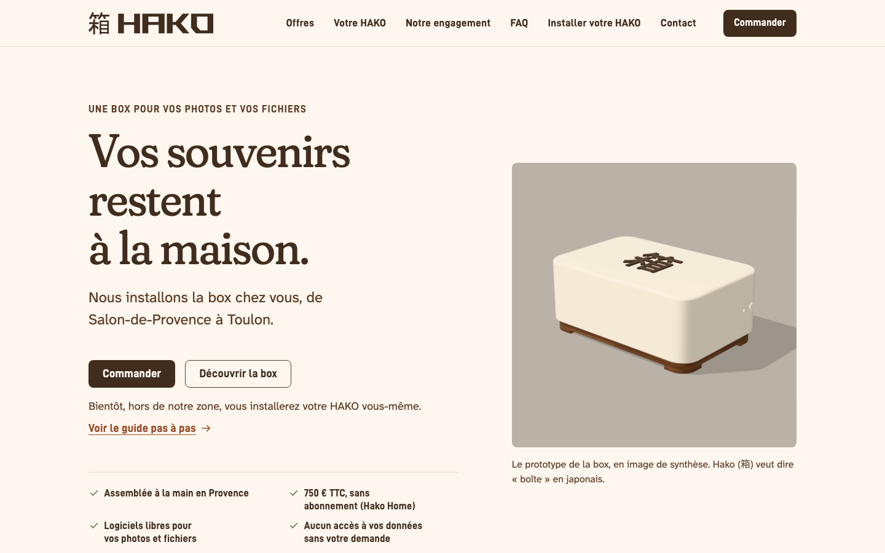
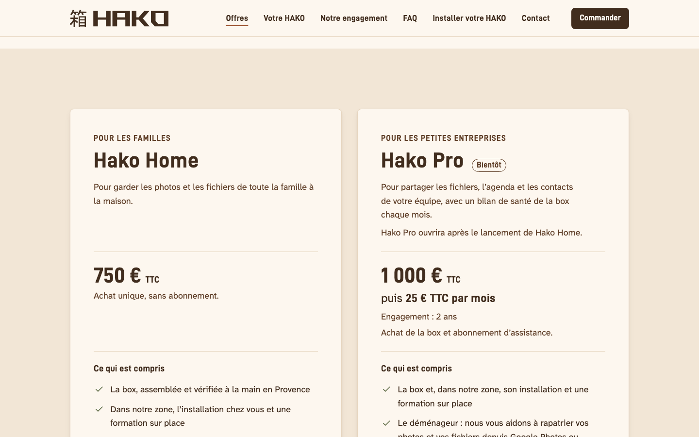
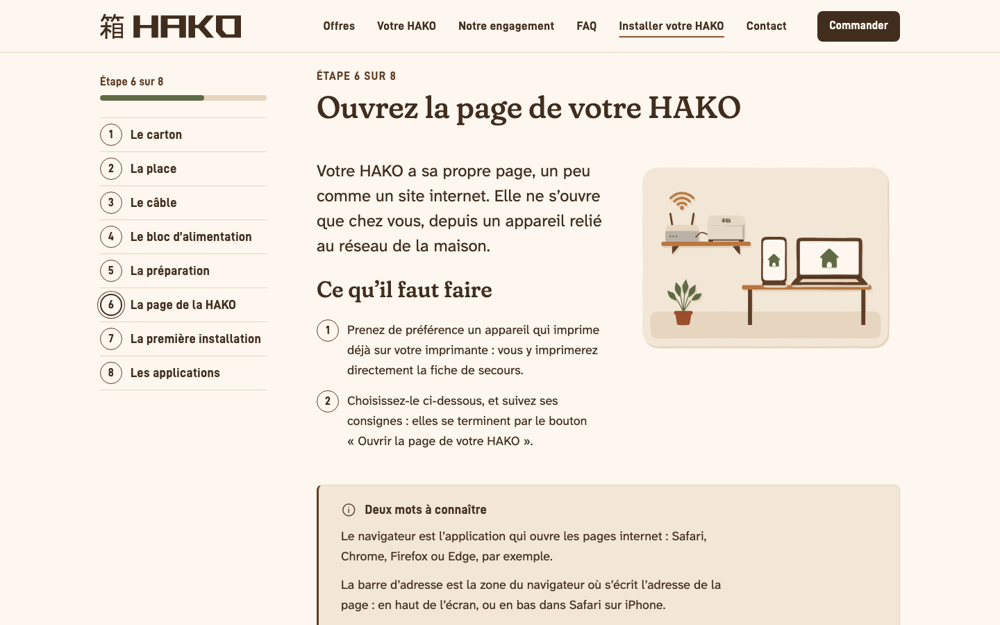
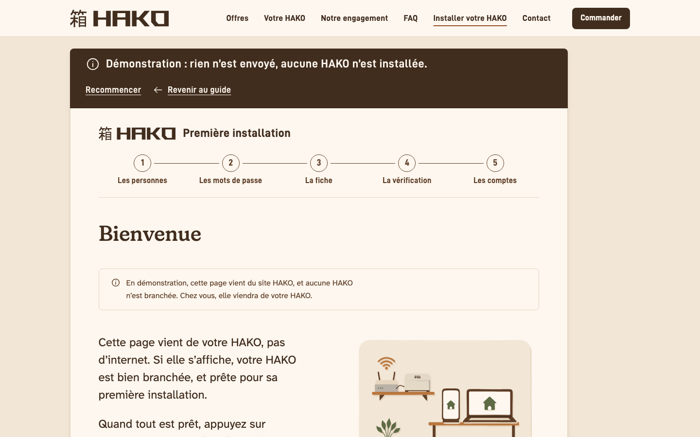
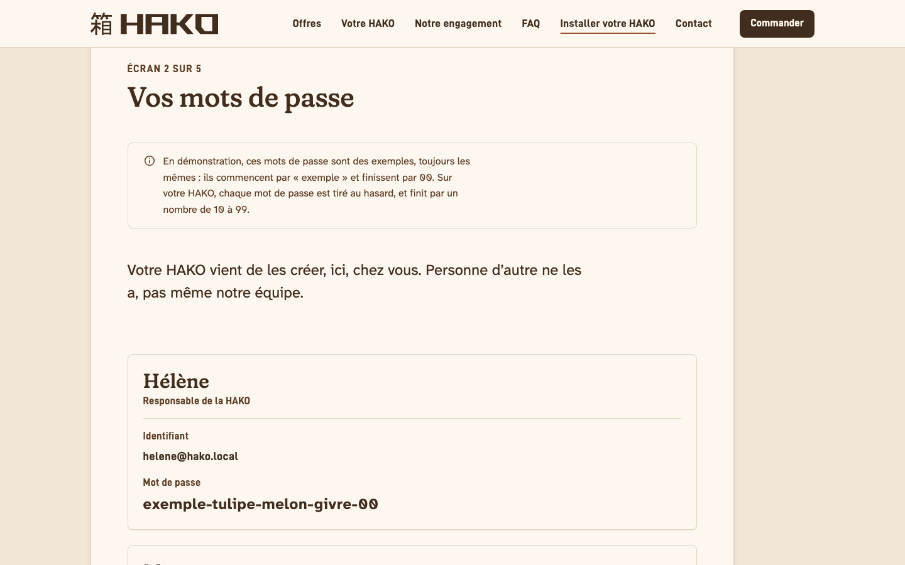
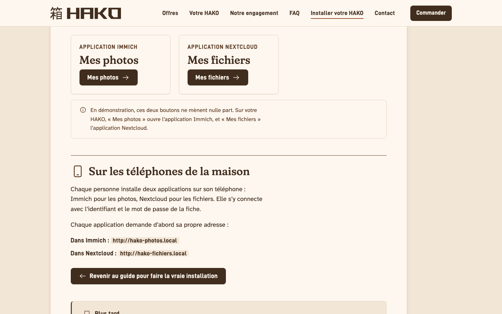

# Le site de HAKO 箱

[](https://github.com/antoninche/hako/actions/workflows/apercu.yml)
[](CHANGELOG.md)
[](LICENSE)
[](https://antoninche.github.io/hako/)

**Le site de la box qui garde les photos et les fichiers de la famille à la maison.**



Ce dossier contient le site public de HAKO, en ligne sur [antoninche.github.io/hako](https://antoninche.github.io/hako/), et la page que la box affiche pour sa première installation. La présentation du projet est dans le [README du dépôt](../README.md) ; HakOS, le système de la box, est dans [hakos/](../hakos/).

## Ce qu'est le site

- **Statique.** Construit avec Astro 7 et TypeScript en mode strict, publié par GitHub Pages à chaque envoi sur `main` qui touche `site/`.
- **Rien qui vous suive.** Aucun cookie, aucun stockage local, aucune mesure d'audience, aucune ressource externe : les polices, le logo et les icônes sont servis par le site.
- **Une politique de sécurité stricte.** Aucun script ni style en ligne : chaque page tient sous une politique de sécurité du contenu (CSP) `default-src 'self'`, que les tests vérifient à 390 et 1440 px. GitHub Pages n'envoie pas cet en-tête ; l'hébergement définitif l'enverra ([docs/hebergement.md](docs/hebergement.md)).
- **Accessible.** Accessibilité visée WCAG 2.2 niveau AA : contraste d'au moins 4,5:1 pour chaque couple texte et fond, cibles tactiles de 44 px, menu au clavier, moins d'animations sur demande.
- **Honnête sur ce qui manque.** Une information encore inconnue (numéro de téléphone, durée à mesurer…) garde un texte provisoire, et `npm run todos` en tient la liste dans [TODO.md](TODO.md).

## Les pages

Treize pages, plus la page 404 : accueil, offres, la box, notre engagement, questions fréquentes, tutoriels, guide d'installation en huit étapes, démonstration de la première installation, commande, contact, conditions générales de vente, mentions légales et données personnelles. La page `/charte/`, interne, montre la charte graphique.

|                                                              |                                                                                      |
| ------------------------------------------------------------ | ------------------------------------------------------------------------------------ |
|  |  |
| Les deux offres, avec leur prix.                             | Le guide d'installation, une étape à la fois.                                        |

|                                                                                                    |                                                                                               |                                                                                             |
| -------------------------------------------------------------------------------------------------- | --------------------------------------------------------------------------------------------- | ------------------------------------------------------------------------------------------- |
|  |  |  |
| La démonstration de la première installation, telle que la box l'affiche.                          | Les mots de passe, créés par la box (ici, ceux de la démonstration).                          | La fin : les adresses des photos et des fichiers.                                           |

## Comment il est construit

- **Astro et TypeScript.** Chaque fichier de `src/pages/` est une page. Les textes sont dans `src/content/`, les informations de l'entreprise et les prix dans `src/data/` (`entreprise.ts`, `tarifs.ts`, `faits.ts`) : un prix ou une adresse ne s'écrit qu'une fois.
- **La scène 3D.** L'accueil montre la box en 3D avec three.js, chargée seulement quand elle approche de l'écran ; une image fixe la remplace si les animations sont réduites ou sans WebGL.
- **La page de la box.** `npm run build:box` construit à part, dans `dist-box/`, la page que la HAKO affiche à http://hako.local pour sa première installation, avec les mêmes composants que la démonstration et l'accès réel à la box. HakOS la copie dans son image à un commit figé (`HAKO_SITE_COMMIT` de [hakos/versions.env](../hakos/versions.env)) ; le contrat entre les deux est dans [docs/page-box.md](docs/page-box.md).
- **Polices, logo et dessins.** Fraunces, Atkinson Hyperlegible Next et D-DIN sont servies par le site ; le logo est vectorisé depuis `brand/`, et les dessins sont produits par un générateur versionné dans `design/illustrations/`.

## Commandes

Toutes les commandes se lancent dans `site/`, après `npm ci` (Node.js 22.23.4 ou plus récent, testé avec Node 26).

| Commande                     | Rôle                                                                                                                |
| ---------------------------- | ------------------------------------------------------------------------------------------------------------------- |
| `npm run dev`                | serveur de développement sur http://localhost:4321, mis à jour à chaque modification                                |
| `npm run build`              | construit le site statique dans `dist/`                                                                             |
| `npm run build:box`          | construit la page de la HAKO dans `dist-box/` (demande `SITE_URL`, par exemple `https://antoninche.github.io/hako`) |
| `npm run preview`            | sert `dist/` sur http://localhost:4321, comme en production                                                         |
| `npm run lint`               | `astro check`, ESLint (règles d'accessibilité comprises), Prettier et contrôle du modèle 3D                         |
| `npm run todos`              | écrit la liste des informations manquantes dans `TODO.md`                                                           |
| `npm run check:dist`         | contrôle `dist/` : aucune ressource d'un autre site, aucun script ni style en ligne, ni cookie                      |
| `npm test`                   | tests unitaires, puis tous les tests Playwright dans Chromium                                                       |
| `npm run screenshots:readme` | refait les captures de ce README dans `images/`, à 1440 px                                                          |
| `npm run social-preview`     | refait l'image de partage du dépôt, `.github/assets/social-preview.png` (1280 × 640 px)                             |

Les autres commandes (polices, logo, dessins, contraste, Lighthouse) et la façon de modifier les textes sont dans [docs/developpement.md](docs/developpement.md).

## Tests

- **Playwright, dans Chromium.** Chaque page s'affiche sans erreur, à 390 et 1440 px ; chaque lien interne mène à une page ou un fichier qui existe ; aucune requête ne quitte la machine et aucun cookie n'est déposé ; la politique de sécurité tient ; tout le parcours de la démonstration et la page de la box fonctionnent.
- **axe-core.** L'accessibilité de chaque page (WCAG 2.2 AA), le lien d'évitement, le menu au clavier et les cibles tactiles.
- **Tests unitaires.** `node --test tests/unit/` : formats et typographie, prix et faits, guide d'installation, modèle 3D, règles et script de la première installation.
- **Le site construit.** `npm run check:dist`, et un test qui vérifie que l'accès réel à la box n'entre jamais dans le site public.

```sh
npx playwright install chromium   # une fois
npm run lint
npm run test:unit
npx playwright test
npm run build && npm run check:dist
SITE_URL=https://antoninche.github.io/hako npm run build:box
```

## Mise en ligne

- **À chaque envoi sur `main`** qui touche `site/`, le workflow [Aperçu en ligne](../.github/workflows/apercu.yml) construit le site, lance `check:dist` et le test du script de la démonstration, puis le publie sur GitHub Pages.
- **Dans un sous-dossier.** Le site est servi à https://antoninche.github.io/hako/ : l'étape `scripts/deploy/sous-dossier.mjs` réécrit les adresses du site construit.
- **Plus tard.** Avec un nom de domaine propre, le site sera publié tel quel, avec ses en-têtes de sécurité : voir [docs/hebergement.md](docs/hebergement.md).

## Organisation du dossier

| Dossier ou fichier           | Contenu                                                                                        |
| ---------------------------- | ---------------------------------------------------------------------------------------------- |
| [src/](src/)                 | pages, textes (`content/`), informations de l'entreprise et prix (`data/`), composants, styles |
| [box/](box/)                 | page de la HAKO pour sa première installation ([docs/page-box.md](docs/page-box.md))           |
| [public/](public/)           | fichiers servis tels quels : polices et leurs licences, logo, icônes, image de partage         |
| [design/](design/)           | captures du prototype 3D et sources des dessins                                                |
| [brand/](brand/)             | PNG d'origine du logo                                                                          |
| [scripts/](scripts/)         | contrôles, polices, logo, page de la HAKO, mise en ligne, image de partage du dépôt            |
| [tests/](tests/)             | tests Playwright et tests unitaires                                                            |
| [docs/](docs/)               | développement, charte graphique, hébergement, page de la HAKO, licences                        |
| [images/](images/)           | bannière et captures d'écran de ce README                                                      |
| [qa/](qa/)                   | images de contrôle de la vectorisation du logo                                                 |
| [CHANGELOG.md](CHANGELOG.md) | journal des versions du site                                                                   |
| [TODO.md](TODO.md)           | informations manquantes (produit par `npm run todos`)                                          |

## Licence

- **Le code du site** est distribué sous licence [MIT](LICENSE).
- **Ce qui reste réservé** : le nom HAKO, son logo, la marque en kanji 箱, les dessins, les photos, les portraits et les textes du site (voir [NOTICE](../NOTICE)).
- **Les polices** Fraunces, Atkinson Hyperlegible Next et D-DIN sont sous SIL Open Font License 1.1, jointe dans [public/fonts/](public/fonts/) ; les autres éléments tiers sont listés avec leur licence dans [docs/licences.md](docs/licences.md).
